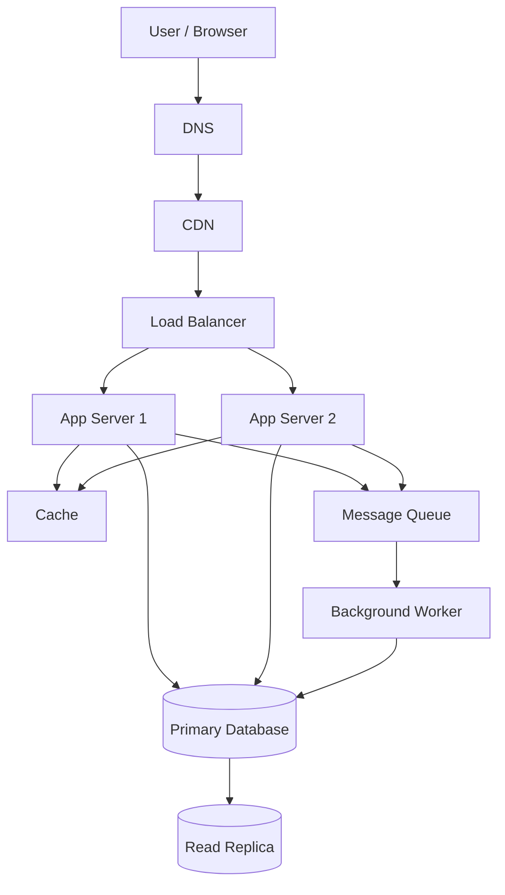

# QuickNotes System Architecture

## 1. Functional Requirements

- Users can create, view, edit and delete notes.
- Users can assign tags to notes.
- Users can view only notes they are authorized to access.
- The system validates input and returns useful errors.
- Users can search and filter their notes.

## 2. Non-Functional Requirements

- Availability target: 99.9%.
- HTTPS for all network traffic.
- Authentication and authorization for protected resources.
- Horizontal scaling of application servers.
- Database backups and tested recovery procedures.
- Monitoring, logging and alerting.
- Acceptable response time for common requests.

## 3. Load Estimate for 1 Million Users

### Assumptions

- 1,000,000 registered users.
- 100,000 daily active users.
- Each active user reads 50 notes per day.
- Each active user creates 2 notes per day.
- Average stored note data: 2 KB, including estimated metadata.
- One year has 365 days.
- Daily traffic is averaged over 24 hours.

### Reads per second

100,000 × 50 = 5,000,000 reads per day.

5,000,000 / 86,400 ≈ 58 reads per second.

### Writes per second

100,000 × 2 = 200,000 writes per day.

200,000 / 86,400 ≈ 2.3 writes per second.

### Storage per year

200,000 notes/day × 365 × 2 KB
= 146,000,000 KB per year.

This is approximately 146 GB per year using decimal units.

This estimate excludes indexes, replicas, backups, logs and database overhead. Peak traffic may be several times higher than the average.

## 4. Architecture Diagram

## 5. Component Responsibilities

- Client: provides the interface users interact with.
- DNS: resolves the application domain to the correct destination.
- CDN: caches static files close to users and reduces origin traffic.
- Load balancer: distributes requests across healthy application servers.
- App Server 1: handles API requests and business logic.
- App Server 2: provides additional capacity and redundancy.
- Cache: stores frequently accessed data to reduce repeated database reads.
- Primary database: handles authoritative writes and transactional updates.
- Read replica: serves eligible read queries and reduces primary database load.
- Message queue: holds background jobs so they do not block API responses.
- Worker: processes asynchronous tasks such as notifications and cleanup.

## 6. GET /notes Request Flow

1. The browser sends GET /api/v1/notes.
2. DNS resolves the application domain.
3. The CDN serves cached static assets if requested.
4. The load balancer forwards the API request to a healthy app server.
5. The app server authenticates the user and checks authorization.
6. The app server checks the cache for an eligible result.
7. On a cache miss, it queries the read replica when safe and sufficiently current.
8. The app server returns the notes as JSON.
9. The cache may store the result briefly, subject to access-control rules.

## 7. POST /notes Request Flow

1. The browser sends POST /api/v1/notes with JSON.
2. The load balancer forwards the request to a healthy app server.
3. The app server authenticates the user and validates the title and body.
4. The app server writes the new note to the primary database in a transaction.
5. The database confirms the write.
6. The app server invalidates affected cached data.
7. A background job can be published to the message queue if required.
8. The API returns 201 Created with the new note.

The API must not report a successful creation before the primary database confirms the transaction.

## 8. Trade-Offs

### SQL versus NoSQL

SQL supports relational integrity and joins but requires thoughtful schema design. PostgreSQL is selected because notes, users and tags have clear relationships.

### Cache versus freshness

Caching improves speed and reduces database load, but stale data may be returned. Use short expiration times and invalidate affected entries after writes.

### Synchronous versus asynchronous work

Synchronous database writes make the result reliable but increase request latency. Background workers handle non-essential tasks asynchronously.

### Read replicas versus consistency

Read replicas improve read capacity but may lag behind the primary. Read-after-write requests can be served by the primary when fresh data is required.

## 9. Avoiding Single Points of Failure

- Run at least two app servers across separate failure domains.
- Use health checks and a redundant load-balancing setup.
- Configure database replication, automated failover and tested backups.
- Deploy redundant cache nodes or a managed cache service with failover.
- Use a durable replicated queue and retry failed jobs safely.
- Monitor all critical services and test disaster recovery.
